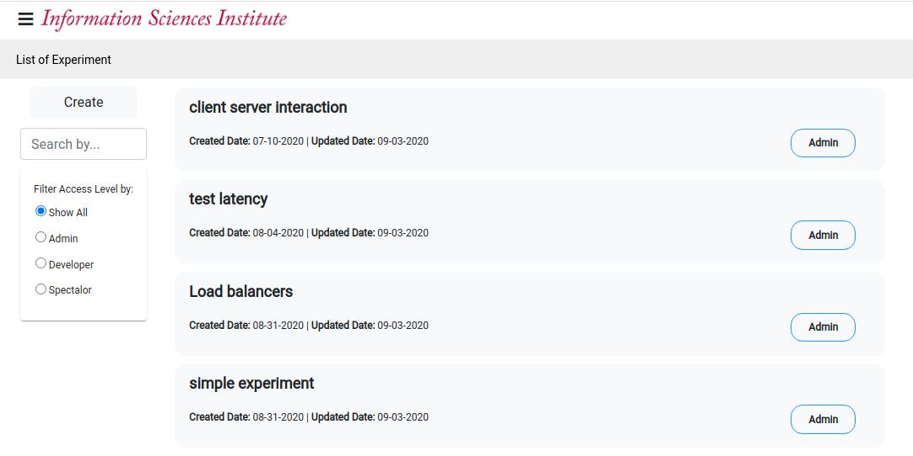
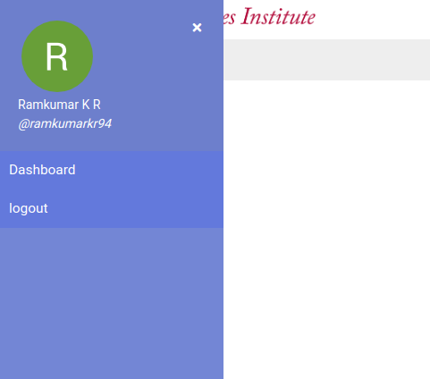
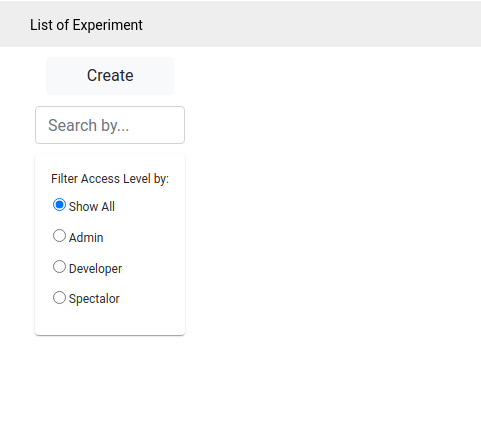

# Dashboard

* The dashboard provides a list of experiments; and options to create a new experiment, edit an existing experiment, or logout. 

    The image below depicts the main page upon successfully logging into the system.
    
    

* Clicking on the menu bar (≡) shows your name, picture, and the logout button. Clicking on the close button removes the menu bar. 

       

* Click on an experiment to open the experiment page. Each experiment list item contains the name, creation date, last updated date, and the role you have in the experiment. 
The possible roles are -
    * **Admin** - Have access to edit and manage access for the experiment. This is the default role assigned to the creator on creating a new experiment.
    * **Developer** - Have access to edit experiment but is not allowed to manage users and roles for the experiment.
    * **Spectator** - Have read only access to the experiment.   
* You can filter the experiments by using the filter options in the left panel of the page.    
* Clicking on the `Create` button allows you to create a new experiment.   
* You will be redirected to the experiment page on either clicking on an experiment, or on clicking the `Create` button.  
