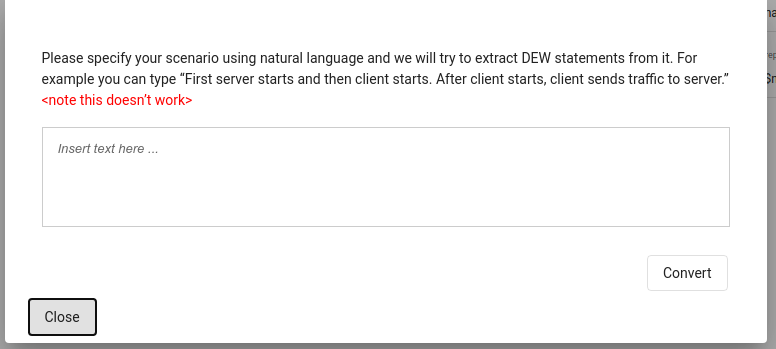

# Experiment page

This is the main page used to edit experiments.


## Experiment name
* The name of the experiment is displayed on the top left corner of the page.
* To edit the name, click on the name and update the text. (just like google docs)
* The name can be a maximum of 101 characters. The number of characters remaining is shown to the right of the name.


## Menu bar
* The menu bar is colored green when the experiment does not contain any unsaved changes.
 
* It is colored grey if the experiment contains unsaved changes. The status is also shown next to the access level to the right.

* The access you have with the experiment is shown in the rightmost column.
* The various buttons and their functions are as follows
### Back button
* Click on the back button to go to the dashboard. Alternatively, you can use the back button in the browser.
### File menu


* This menu contains a number of file related operations. They are -
#### Save
* Clicking on save will save the current experiment to the database.
#### Save to google drive
* This button allows you to save the experiment to google drive. The experiment is saved in DEW format.
* The user will have a top level directory called “Distributed Experiment Workflows”. 
* Inside the top level directory, we have folders created for each experiment.
* Files related to the experiment will be contained in the experiment’s folder
* For example, if we have an experiment named "test", the dew file is located at `MyDrive > Distributed Experiment Workflows > test > test.dew`
#### Delete
* Deletes the experiment.

#### Version history
* View the changes done previously to the experiment. 
* To revert to a particular version, click on the revert button


#### Share to user
* Share the experiment to another DEW user for access


#### List of users
* View and manage the list of users who can access the experiment


#### Share link
* Share the experiment to the public by generating a unique link

#### Close
* Close the experiment and go back to the dashboard

#### Create
* When the experiment is not saved at all, you get a create button which saves the experiment.


### Input

This menu allows the user to upload an experiment using different methods.


#### Upload
Upload DEW files to load the experiment. For example, the dew file saved in google drive can be used for upload.


#### NLP

* Write using natural language to generate DEW statements. The idea is to just type in the requirements and the appropriate DEW file is generated. 
* This feature is currently experimental and may not work as expected for all cases.



### Export


This menu is used to export the experiment to different formats


#### NS file
* Download the NS file for the current experiment

#### BASH file
* Download the Bash scripts for running the given experiment

## Dependency graph


* In order to understand the experiment better, we have a graph view which displays the experiment as a flowchart. 
* The graph viewer also supports editing edges.
* To access the graph, click on the **Dependency graph** option in the menu bar.
* To go back to the experiment, click on the **Experiment** option in the menu bar.


### Editing edges
* To add an edge, toggle the switch, click on the source (hold the button and do not release) and drag the arrow till the destination.


* To delete an edge, click on the red box next to the edge. Please note that the mouse icon changes when a node or edge is clickable.


### Zoom and scroll
* To zoom in or zoom out, use the (+) and (-) buttons to increase or decrease the zoom level
* Please use the panning functionality instead of scrolling. (Click on the white area and drag in the desired direction)

## Behavior, Constraints, and Bindings

 * In DEW, an experiment consists of a scenario (who does what and when), constraints (how experiment should be materialized on a testbed) and bindings (specific commands to run on nodes for each action). 

### Behavior

* Behavior defines the steps to be executed during this experiment.
* Behavior statements will be in the form of
```
[when <event>][wait <time>] actor action [emit <event>]
```

* For example:
```
actor0 start_log
wait t0 actor1 legitimate
when stop_attack_done wait t3 actor1 stop_legitimate emit stop_legitimate_done
```

* As you start typing there will be auto-suggestion displayed near the top of the text area.
* Press tab to use the first auto suggested word. It will append the word near the cursor in the textarea.
* There will also be suggestion displayed along with suggested text. This will help you to write the next word or phrase. 

### Constraints

* The constraints section defines all the constraints for this experiment.
* The statements will be in the form of
```
actor constraint_type value
```
* The allowed constraint types are
    * os
    * num
    * link
    * lan
    * interfaces
    * location
    * nodetype
* For example:
```
os server ubuntu
num attacker 3
lan client attacker
link router server 
```

* As you start typing there will be auto-suggestion displayed near the top of the text area.
* Press tab to use the first auto suggested word. It will append the word near the cursor in the textarea.
* There will also be suggestion displayed along with suggested text. This will help you to write the next word or phrase. 

### Bindings

* Define all the constraints for this experiment.
* Choose an option from drop-down boxes or input your own commands. Variables are preceded by `$` to indicate that their values should be replaced by constants in the design stage, or specified by user at run-time on the command line.
* For example:
```
install_iperf apt-get install iperf -y
install_tcpdump apt-get install tcpdump -y
install_flooder /scripts/common/install_flooder.sh
start_server iperf -s 
```
* As you start typing behavior above this area will be populated with the terms which require definition for the experiment to execute. 

