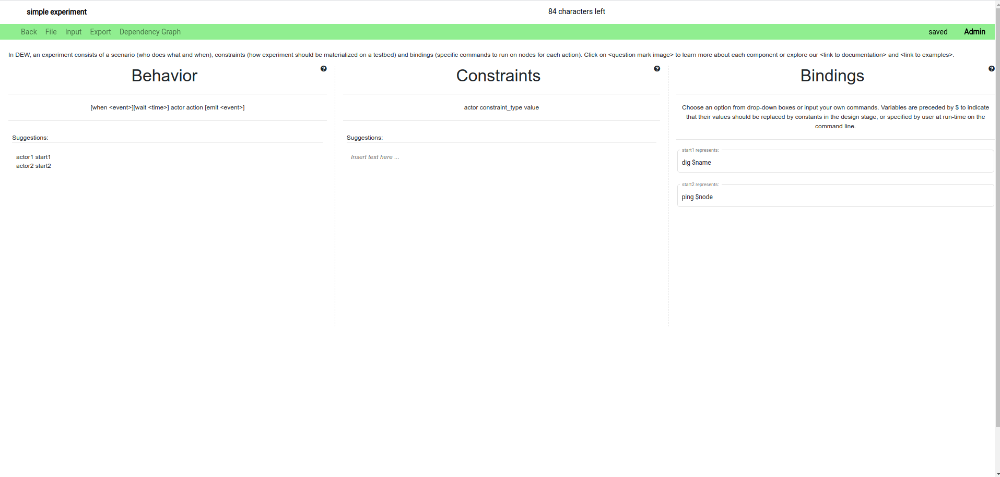
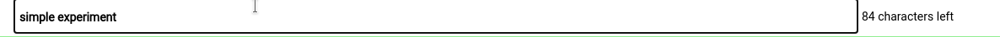
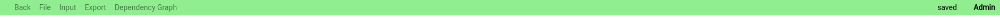
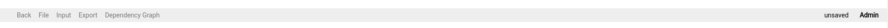
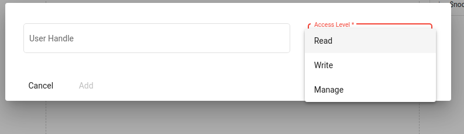
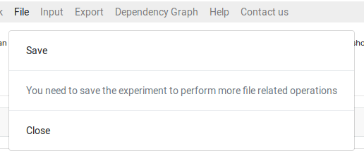
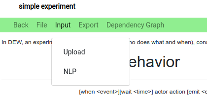
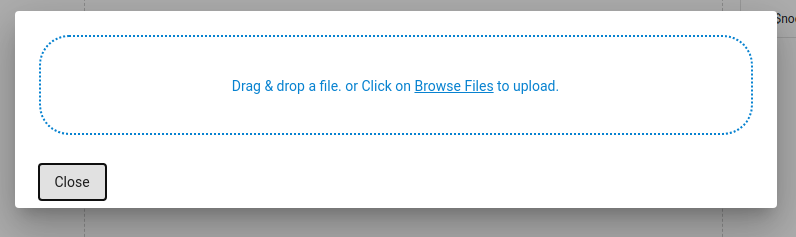
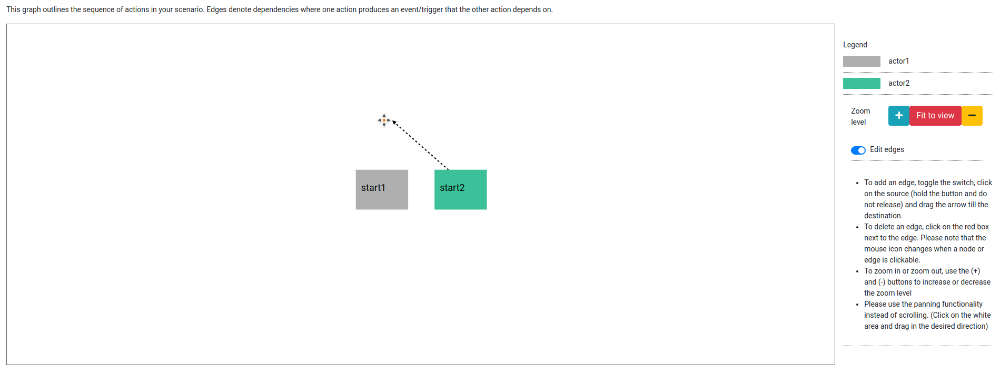
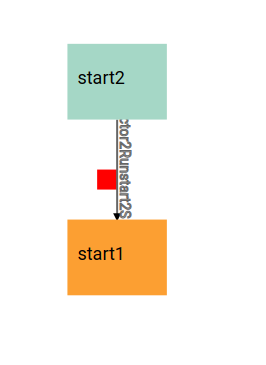

# Experiment page


<!-- TODO: Change this content -->
This is the main page used to create new or edit existing experiments.



View video tutorials on using the experiment page below - 
<iframe width="560" height="315" src="https://www.youtube.com/embed/JNOLuf4gwUc" frameborder="0" allow="accelerometer; autoplay; clipboard-write; encrypted-media; gyroscope; picture-in-picture" allowfullscreen></iframe>

<iframe width="560" height="315" src="https://www.youtube.com/embed/5q8fAJtRyUA" frameborder="0" allow="accelerometer; autoplay; clipboard-write; encrypted-media; gyroscope; picture-in-picture" allowfullscreen></iframe>

<!-- Upto here -->

## Experiment name
* The name of the experiment is displayed on the top left corner of the page.
* To edit the name, click on the name and update the text. (just like Google Docs)
* The name can be a maximum of 101 characters. The number of characters remaining is shown towards the right of the name.


## Menu bar
* The menu bar is colored green when the experiment does not contain any unsaved changes.
 
* It is colored grey if the experiment contains unsaved changes. The status is also shown next to the access level to the right.

* The access you have with the experiment is shown in the rightmost column.
* The various buttons and their functions are as follows
### Back button
* Click on the back button to go to the dashboard. Alternatively, you can use the back button in the browser.
### File menu


* This menu contains a number of file related operations. They are -
#### Save
* Clicking on save will save the current experiment to the database.
#### Save to Google Drive
* This button allows you to save the experiment to Google Drive. The experiment is saved in DEW format.
* The user will have a top level directory called “Distributed Experiment Workflows”. 
* Inside the top level directory, we have folders created for each experiment.
* Files related to the experiment will be contained in the experiment’s folder
* For example, if we have an experiment named "test", the DEW file is located at `MyDrive > Distributed Experiment Workflows > test > test.dew`
#### Delete
* Deletes the experiment in DEW portal. This is a **non-recoverable** action. The experiment will still remain on your Google Drive, if you have saved it there.

#### Version history
* View the changes done previously to the experiment. 
* To revert to a particular version, click on the revert button


#### Share to user
* Share the experiment to another DEW user for access. To learn more about sharing and access levels, visit [Sharing and Collaboration page](./sharing_and_collaboration/)


#### List of users
* View and manage the list of users who can access the experiment. To learn more about sharing and access levels, visit [Sharing and Collaboration page](./sharing_and_collaboration/)


#### Close
* Close the experiment and go back to the dashboard

#### Create
* When the experiment is not saved at all, you get a Save button which saves the experiment. Other file operations can be performed after saving the experiment.



### Input

This menu allows the user to upload an experiment using  DEW format or from a Bash script. We hope to support more experiment formats in the near future.



#### Upload
Upload DEW files to load the experiment. For example, the DEW file saved in Google Drive can be used for upload.




### Export


This menu is used to export the experiment to different formats


#### NS file
* Download the NS file for the current experiment

#### BASH file
* Download the Bash script or scripts for the experiment. Currently the scripts should be run on Deterlab, from the users machine. Running the script without arguments will display a help message to tell you which input parameters you need to specify.

#### DEW
* Download the DEW file of the current experiment.

## Dependency graph


* In order to understand the experiment better, we have a graph view which displays the experiment as a flowchart of actions. The nodes denote actions, with the color of the node denoting the actor that performs the given action. Edges denote a dependency, where one action results in an event and a following action waits for that event. You can create new edges (dependencies) between nodes or delete existing edges (dependencies). As you modify the dependency graph the modifications are propagated to the Experiment view. 
* The graph viewer also supports editing edges.
* To access the graph, click on the **Dependency graph** option in the menu bar.
* To go back to the experiment, click on the **Experiment** option in the menu bar.


### Editing edges
* To add an edge, toggle the switch, click on the source (hold the button and do not release) and drag the arrow till the destination.



* To delete an edge, click on the red box next to the edge. Please note that the mouse icon changes when a node or edge is clickable.



### Zoom and scroll
* To zoom in or zoom out, use the (+) and (-) buttons to increase or decrease the zoom level
* Please use the panning functionality instead of scrolling. (Click on the white area and drag in the desired direction)

## Behavior, Constraints, and Bindings

 * In DEW, an experiment consists of a scenario (who does what and when), constraints (how experiment should be materialized on a testbed) and bindings (specific commands to run on nodes for each action). 

### Behavior

* Behavior defines the actions to be executed by actors during the experiment. You can think of an actor as a node in an experiment, or as many nodes that perform the same set of actions. You can think of an action as one or more commands executed on a node in an experiment. An action can result in an event (we say that it emits an event) and a later action will occur only when that event is generated. For example you may want to install an Apache application on the “server” node, and then generate traffic to it from a “client” node when the installation is completed. Two actions that are not connected by emit-when rules occur independently and in parallel. Please explore our [examples](/examples) to get familiar with some common uses of DEW language.
* Behavior statements are in the form of
```
[when <event>][wait <time>] actor action [emit <event>]
```

* For example, if you want to express the following behavior **"A pings B, after that B waits 5 sec and pings A"** you would write:
```
A start_ping1 emit ping1_done
when ping1_done wait 5 B start_ping2
```
Conversely if you wanted **A and B to ping each other in parallel** you would write:
```
A start_ping1
B start_ping2
```
Names of actors will eventually correspond to names of nodes in your experiments. Names of actions are chosen by you. You will get to define what they mean in the bindings section.

* As you start typing there will be auto-suggestion displayed near the top of the text area.
* Press tab to use the first auto suggested word. It will append the word near the cursor in the textarea.
* There will also be suggestion displayed along with suggested text. This will help you to write the next word or phrase. 

### Constraints

* The constraints section helps define any constraints about the topology of the experiment, as it will be materialized on a testbed.
* The statements are in the form of
```
constraint_type actor1 [actor2|value]
```
* The allowed constraint types are
    * os
    * num
    * link
    * lan
    * interfaces
    * location
    * nodetype
* For example:
```
os server ubuntu
num attacker 3
lan client attacker
link router server 
```

* As you start typing there will be auto-suggestion displayed near the top of the text area.
* Press tab to use the first auto suggested word. It will append the word near the cursor in the textarea.
* There will also be suggestion displayed along with suggested text. This will help you to write the next word or phrase. 

### Bindings

* The bindings section defines the commands to be executed on testbed nodes for the given action or event in your experiment.
* Choose an option from drop-down boxes or input your own commands. Variables are preceded by `$` to indicate that their values should be replaced by constants in the design stage, or specified by user at run-time on the command line.
* For example:
```
install_iperf apt-get install iperf -y
run_tcpdump tcpdump -i expIP -w $file
install_flooder /scripts/common/install_flooder.sh
start_server iperf -s 
```
* As you start typing behavior above this area will be populated with the terms which require definition for the experiment to execute. 

We have provided some suggestions for action and event bindings. Please look at the [binding suggestions](/binding_suggestions) page for more information.
